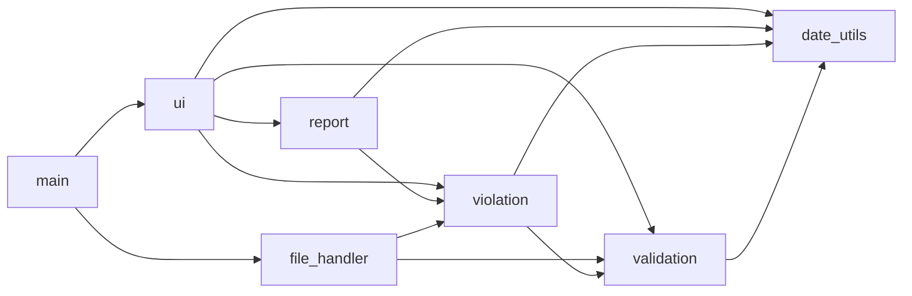
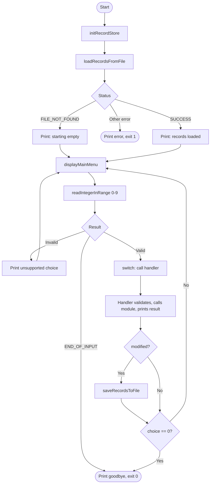
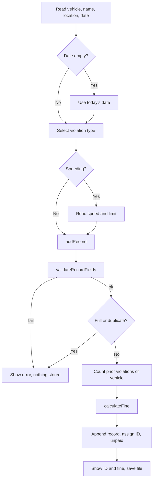

# Detailed Software Design: Traffic Violation Record Management System

## 1. Software Architecture

The application is split into layers. Dependencies only point downwards (no module calls "up" into the interface).

| Layer | Modules | Notes |
|-------|---------|-------|
| Interface | `main.c`, `ui.c` | Console input / output, menu, dispatching |
| Business logic | `violation.c`, `validation.c`, `date_utils.c` | Rules, fines, validation, date arithmetic |
| Report | `report.c` | Statistics, sorting, filtering, printing |
| Storage | `file_handler.c` | Text-file persistence |
| Common | `status.c`, `config.h` | Status codes, constants |

Module dependencies:

## 2. Module Design

| Module | Source / header | Purpose | Public functions | Data | Depends on | Status codes returned |
|--------|-----------------|---------|------------------|------|------------|-----------------------|
| Main | `main.c` | Entry point and menu loop | `main` | `RecordStore_t` (local) | ui, file_handler, violation | exit code 0 / 1 |
| UI | `ui.c` / `ui.h` | Safe input and menu actions | `readLine`, `readIntegerInRange`, `displayMainMenu`, `handleAddRecord`, `handleListRecords`, `handleSearchById`, `handleVehicleHistory`, `handleMarkPaid`, `handleDeleteRecord`, `handleOverdueReport`, `handleSortedByFine`, `handleSummaryReport` | input buffers | report, violation, validation, date_utils | `STATUS_END_OF_INPUT`, `STATUS_INVALID_INPUT` |
| Violation | `violation.c` / `violation.h` | Data model and record rules | `initRecordStore`, `calculateFine`, `addRecord`, `findRecordIndexById`, `deleteRecord`, `markRecordPaid`, `countViolationsByVehicle`, `isRecordOverdue`, `violationTypeToString`, `paymentStatusToString` | `ViolationRecord_t`, `RecordStore_t` | validation, date_utils | `NULL_POINTER`, `INVALID_*`, `STORAGE_FULL`, `DUPLICATE`, `NOT_FOUND`, `EMPTY_STORE`, `ALREADY_PAID` |
| Validation | `validation.c` / `validation.h` | Validate fields, parse numbers | `validateVehicleNumber`, `validateName`, `validateLocation`, `validateDate`, `validateSpeedPair`, `validateViolationType`, `validateFineAmount`, `validateRecordFields`, `parseInteger`, `parseDouble` | none | date_utils | `NULL_POINTER`, `INVALID_*` |
| Date utilities | `date_utils.c` / `date_utils.h` | Calendar logic | `isLeapYear`, `daysInMonth`, `parseDate`, `daysBetweenDates`, `getTodayDate` | none | none | `NULL_POINTER`, `INVALID_DATE`, `INVALID_ARGUMENT` |
| File handler | `file_handler.c` / `file_handler.h` | Persistence | `loadRecordsFromFile`, `saveRecordsToFile` | text data file | validation, violation | `FILE_NOT_FOUND`, `FILE_OPEN_FAILED`, `FILE_IO_FAILED`, `FILE_INVALID_DATA` |
| Report | `report.c` / `report.h` | Output and statistics | `computeSummary`, `sortRecordsByFineDescending`, `buildSortedByFine`, `collectVehicleRecords`, `collectOverdueRecords`, `countOverdueRecords`, `printRecordTable`, `printRecordDetails`, `printSummaryReport`, `writeSummaryReport` | `ReportSummary_t` | violation | `EMPTY_STORE`, `NOT_FOUND`, `MEMORY_FAILURE`, `FILE_*` |
| Status | `status.c` / `status.h` | Messages | `statusToString` | `Status_t` | none | not applicable |

`main.c` only initialises the store, loads data, shows the menu, calls the handlers, saves after modifications and exits.

## 3. Data Design

### 3.1 Structures

**`ViolationRecord_t`** - one traffic violation.

| Member | C type | Valid range / size | Description |
|--------|--------|--------------------|-------------|
| `id` | `int` | 1 .. `INT_MAX`, unique | Record identifier assigned by the system |
| `vehicleNumber` | `char[11]` | 6-10 chars, `A-Z0-9` | Vehicle registration number |
| `driverName` | `char[51]` | 1-50 chars | Name of the driver |
| `location` | `char[61]` | 1-60 printable chars, no `\|` | Place of the violation |
| `date` | `char[11]` | `YYYY-MM-DD`, years 2000-2100 | Date of the violation |
| `type` | `ViolationType_t` | 0 .. 4 | Kind of violation |
| `recordedSpeed` | `int` | 1-250 for speeding, otherwise 0 | Measured speed (km/h) |
| `speedLimit` | `int` | 1-250 for speeding, otherwise 0 | Posted speed limit (km/h) |
| `fineAmount` | `double` | 0 < fine <= 100000 | Fine in rupees |
| `paymentStatus` | `PaymentStatus_t` | 0 .. 1 | Unpaid or paid |

**`RecordStore_t`** - the in-memory database: `ViolationRecord_t records[MAX_RECORDS]`, `size_t count`, `int nextId`.

**`ReportSummary_t`** - `totalRecords`, `unpaidRecords`, `totalFines`, `collectedFines`, `outstandingFines`, `typeCounts[VIOLATION_TYPE_COUNT]`.

### 3.2 Enumerations

| Enumeration | Constants |
|-------------|-----------|
| `ViolationType_t` | `VIOLATION_SPEEDING`(0), `VIOLATION_RED_LIGHT`, `VIOLATION_NO_HELMET`, `VIOLATION_NO_SEATBELT`, `VIOLATION_ILLEGAL_PARKING`, `VIOLATION_TYPE_COUNT` |
| `PaymentStatus_t` | `PAYMENT_UNPAID`(0), `PAYMENT_PAID`, `PAYMENT_STATUS_COUNT` |
| `Status_t` | `STATUS_SUCCESS`(0) and the error codes listed in section 11 |

### 3.3 Constants (`config.h`)

| Constant | Value | Purpose |
|----------|-------|---------|
| `MAX_RECORDS` | 500 | Storage capacity |
| `VEHICLE_NUMBER_MIN_LEN` / `MAX_LEN` | 6 / 10 | Vehicle number length |
| `DRIVER_NAME_MAX_LEN` | 50 | Name length |
| `LOCATION_MAX_LEN` | 60 | Location length |
| `DATE_STRING_LEN` | 10 | `YYYY-MM-DD` |
| `MIN_YEAR` / `MAX_YEAR` | 2000 / 2100 | Accepted years |
| `MIN_SPEED_KMH` / `MAX_SPEED_KMH` | 1 / 250 | Accepted speeds |
| `MAX_FINE_AMOUNT` | 100000.0 | Upper fine limit and cap |
| `FINE_SPEEDING_BASE` / `FINE_SPEEDING_PER_KMH` | 1000 / 100 | Speeding fine rule |
| `FINE_RED_LIGHT` / `NO_HELMET` / `NO_SEATBELT` / `ILLEGAL_PARKING` | 1000 / 500 / 500 / 300 | Fixed fines |
| `REPEAT_OFFENDER_THRESHOLD` / `MULTIPLIER` | 3 / 2.0 | Repeat-offender rule |
| `PAYMENT_DUE_DAYS` | 30 | Days before a fine is overdue |
| `FIELD_DELIMITER` | `\|` | File field separator |
| `FILE_FIELD_COUNT` | 10 | Fields per file record |
| `LINE_BUFFER_SIZE` | 256 | Longest accepted file line |
| `INPUT_BUFFER_SIZE` | 128 | Console input buffer |
| `DEFAULT_DATA_FILE` / `SUMMARY_REPORT_FILE` | `data/violations.txt` / `data/summary_report.txt` | File names |

### 3.4 Data dictionary

| Data item | C type | Valid range / size | Validation rule | Description |
|-----------|--------|--------------------|-----------------|-------------|
| Vehicle number | `char[11]` | 6-10 chars | Uppercase letters and digits only | Registration number |
| Driver name | `char[51]` | 1-50 chars | Letters, space, `.`, `-`, `'`; at least one letter | Driver |
| Location | `char[61]` | 1-60 chars | Printable, not blank, no `\|` | Place |
| Date | `char[11]` | `YYYY-MM-DD` | Real calendar date, year 2000-2100 | Violation date |
| Violation type | `ViolationType_t` | 0-4 | Must be a defined enumerator | Category |
| Speed / limit | `int` | 1-250 | Speed > limit, only for speeding | km/h values |
| Fine | `double` | 0-100000 | `0 < fine <= MAX_FINE_AMOUNT`, finite | Rupees |
| Payment status | `PaymentStatus_t` | 0-1 | Defined enumerator | Paid / unpaid |
| Record ID | `int` | >= 1 | Unique in the store | Identifier |

Relationships: a vehicle can have many records (found by `vehicleNumber`); a record belongs to exactly one vehicle.

## 4. Function Design (important functions)

| Function (module) | Prototype | Purpose | Return values | Preconditions / postconditions |
|-------------------|-----------|---------|---------------|--------------------------------|
| `calculateFine` (violation) | `Status_t calculateFine(ViolationType_t type, int speed, int limit, size_t priorViolations, double *fine)` | Compute the fine from the fine rules | `SUCCESS`, `NULL_POINTER`, `INVALID_TYPE`, `INVALID_SPEED` | `fine` not NULL. On success `*fine` is set, capped at `MAX_FINE_AMOUNT`; unchanged on error |
| `addRecord` (violation) | `Status_t addRecord(RecordStore_t *store, const ViolationRecord_t *input, int *newId)` | Validate, reject duplicate, compute fine, append | `SUCCESS`, `NULL_POINTER`, `INVALID_*`, `STORAGE_FULL`, `DUPLICATE` | On success `count` +1, id assigned, status unpaid; on error store unchanged |
| `findRecordIndexById` (violation) | `Status_t findRecordIndexById(const RecordStore_t *store, int id, size_t *index)` | Locate a record | `SUCCESS`, `NULL_POINTER`, `EMPTY_STORE`, `NOT_FOUND` | `*index` set only on success |
| `deleteRecord` (violation) | `Status_t deleteRecord(RecordStore_t *store, int id)` | Remove a record and close the gap | as `find...` | `count` decreases by 1 on success |
| `markRecordPaid` (violation) | `Status_t markRecordPaid(RecordStore_t *store, int id)` | Set status to paid | `SUCCESS`, `NOT_FOUND`, `EMPTY_STORE`, `ALREADY_PAID` | Status paid after success |
| `countViolationsByVehicle` (violation) | `size_t countViolationsByVehicle(const RecordStore_t *store, const char *vehicleNumber)` | Count a vehicle's records | count (0 for NULL) | Read-only |
| `isRecordOverdue` (violation) | `Status_t isRecordOverdue(const ViolationRecord_t *record, const char *today, int *overdue)` | Status determination | `SUCCESS`, `NULL_POINTER`, `INVALID_DATE` | `*overdue` = 1 only if unpaid and more than 30 days old |
| `validateVehicleNumber` (validation) | `Status_t validateVehicleNumber(const char *vehicleNumber)` | Check vehicle number format | `SUCCESS`, `NULL_POINTER`, `INVALID_VEHICLE_NUMBER` | none |
| `validateName`, `validateLocation` (validation) | `Status_t validateName(const char *name)` | Check text fields | `SUCCESS`, `NULL_POINTER`, `INVALID_NAME` / `INVALID_LOCATION` | none |
| `validateDate` (validation) | `Status_t validateDate(const char *date)` | Check a real `YYYY-MM-DD` date | `SUCCESS`, `NULL_POINTER`, `INVALID_DATE` | none |
| `validateSpeedPair` (validation) | `Status_t validateSpeedPair(int speed, int limit)` | Check speeding values | `SUCCESS`, `INVALID_SPEED` | speed > limit, both 1-250 |
| `validateRecordFields` (validation) | `Status_t validateRecordFields(const ViolationRecord_t *record)` | Check all user-supplied fields | first failing validator's code | none |
| `parseInteger` (validation) | `Status_t parseInteger(const char *text, int min, int max, int *value)` | Strict text to int | `SUCCESS`, `NULL_POINTER`, `INVALID_INPUT` | `*value` unchanged on error |
| `parseDate` (date_utils) | `Status_t parseDate(const char *date, int *y, int *m, int *d)` | Parse and validate a date | `SUCCESS`, `NULL_POINTER`, `INVALID_DATE` | fields set only on success |
| `daysBetweenDates` (date_utils) | `Status_t daysBetweenDates(const char *from, const char *to, long *diff)` | Day difference | `SUCCESS`, `NULL_POINTER`, `INVALID_DATE` | `*diff` = to - from |
| `loadRecordsFromFile` (file_handler) | `Status_t loadRecordsFromFile(RecordStore_t *store, const char *path)` | Read the database | `SUCCESS`, `FILE_NOT_FOUND`, `FILE_OPEN_FAILED`, `FILE_INVALID_DATA`, `FILE_IO_FAILED` | Store is empty after any failure |
| `saveRecordsToFile` (file_handler) | `Status_t saveRecordsToFile(const RecordStore_t *store, const char *path)` | Write the database | `SUCCESS`, `NULL_POINTER`, `FILE_OPEN_FAILED`, `FILE_IO_FAILED` | File contains all records |
| `computeSummary` (report) | `Status_t computeSummary(const RecordStore_t *store, ReportSummary_t *summary)` | Totals and counts | `SUCCESS`, `EMPTY_STORE`, `NULL_POINTER` | Summary zeroed on empty store |
| `sortRecordsByFineDescending` (report) | `Status_t sortRecordsByFineDescending(ViolationRecord_t *records, size_t count)` | Sort an array | `SUCCESS`, `NULL_POINTER` | Highest fine first, ties by id |
| `buildSortedByFine`, `collectVehicleRecords`, `collectOverdueRecords` (report) | `Status_t collectVehicleRecords(const RecordStore_t *store, const char *vehicle, ViolationRecord_t **out, size_t *count)` | Build result lists with `malloc` | `SUCCESS`, `EMPTY_STORE` / `NOT_FOUND`, `MEMORY_FAILURE` | Caller frees `*out`; nothing allocated on error |
| `writeSummaryReport` (report) | `Status_t writeSummaryReport(const RecordStore_t *store, const char *path, const char *generatedDate)` | Export the summary | `SUCCESS`, `EMPTY_STORE`, `FILE_OPEN_FAILED`, `FILE_IO_FAILED` | Report file created |
| `readLine` (ui) | `Status_t readLine(const char *prompt, char *buffer, size_t size)` | Safe line input | `SUCCESS`, `END_OF_INPUT`, `INVALID_INPUT` (too long) | Rest of an over-long line is discarded |

## 5. Input-Validation Plan

| Input | Source | Validation rule | Invalid example | Expected behaviour |
|-------|--------|-----------------|-----------------|--------------------|
| Menu choice | User | Integer 0-9 | `abc`, `12`, empty | "Unsupported menu choice", menu shown again |
| Record ID | User | Integer >= 1, must exist | `0`, `-3`, `999` | Error message, no change |
| Vehicle number | User / File | 6-10 uppercase letters / digits (console input is uppercased first) | `MH-12`, `AB1` | `INVALID_VEHICLE_NUMBER` |
| Driver name | User / File | 1-50 chars, letters / space / `.` / `-` / `'` | `R2D2`, empty | `INVALID_NAME` |
| Location | User / File | 1-60 printable chars, not blank, no `\|` | `MG\|Road`, spaces only | `INVALID_LOCATION` |
| Date | User / File | `YYYY-MM-DD`, real date, 2000-2100 | `2023-02-29`, `2024/01/01` | `INVALID_DATE` |
| Violation type | User / File | 1-5 in the menu (0-4 in file) | `9` | `INVALID_INPUT` / `INVALID_TYPE` |
| Speed and limit | User / File | 1-250, speed > limit (speeding only); 0 for other types | `60 / 60`, `300` | `INVALID_SPEED` |
| Fine | File | Finite number, 0 < fine <= 100000 | `-5`, `abc` | `FILE_INVALID_DATA` |
| Payment status | File | 0 or 1 | `2` | `FILE_INVALID_DATA` |
| Duplicate record | User | Same vehicle + date + type + location | repeated entry | `DUPLICATE` |
| Over-long input | User | Longer than buffer / field | 200 characters | `INVALID_INPUT`, rest of line discarded |
| Field count / line length | File | Exactly 10 fields, line under 256 chars | missing field | `FILE_INVALID_DATA` |

Strategy: all console text is read with `fgets` (never `scanf`/`gets`); numbers are parsed with `strtol` / `strtod`, rejecting empty text, trailing characters, overflow and out-of-range values. The same validators are used for console input and for data read from the file.

## 6. File-Handling Plan

| File | Purpose | Format | Created by | Read by | Updated by |
|------|---------|--------|------------|---------|------------|
| `data/violations.txt` | Working database | Text, one record per line | `make run` (copy of sample) or first save | `loadRecordsFromFile` at start-up | `saveRecordsToFile` after every change |
| `data/sample_data.txt` | Demonstration data | Text | Developer | `make run` (copied) | never by the program |
| `data/summary_report.txt` | Exported summary | Text | `writeSummaryReport` | User | Overwritten on each export |

Record format: `id|vehicle|driver|location|date|type|speed|limit|fine|payment`. Lines starting with `#` and blank lines are ignored.

| Operation | Function | C library function | Failure handling |
|-----------|----------|--------------------|------------------|
| Open for read | `loadRecordsFromFile` | `fopen("r")` | `ENOENT` gives `FILE_NOT_FOUND` (start empty), otherwise `FILE_OPEN_FAILED` |
| Read | `loadRecordsFromFile` | `fgets`, `ferror` | Over-long line gives `FILE_INVALID_DATA`; read error gives `FILE_IO_FAILED` |
| Open for write | `saveRecordsToFile`, `writeSummaryReport` | `fopen("w")` | `FILE_OPEN_FAILED` |
| Write | same | `fprintf` | Negative result gives `FILE_IO_FAILED` |
| Close | all | `fclose` | Non-zero result gives `FILE_IO_FAILED` |

| Error condition | Detection | Expected behaviour |
|-----------------|-----------|--------------------|
| File does not exist | `errno == ENOENT` | Start with an empty database, create the file on first save |
| File cannot be opened | `fopen` returns NULL | Report the error; at start-up the program exits without touching the file |
| File is empty | Zero records read | Valid, empty database |
| File contains invalid data | Field count, validators, duplicate id, capacity | `FILE_INVALID_DATA`; store emptied; program refuses to start so the file is not overwritten |
| Read or write fails | `ferror`, negative `fprintf`, `fclose` failure | `FILE_IO_FAILED`, warning shown |

## 7. Error-Handling Strategy

All functions that can fail return `Status_t`; `STATUS_SUCCESS` is 0. `statusToString` converts a code to a user message. The UI always checks the return value, prints the message and returns to the menu without changing data.

| Error ID | Error condition | Detection location | Status | User-facing behaviour |
|----------|-----------------|--------------------|--------|-----------------------|
| ERR-01 | NULL pointer argument | Start of every function | `STATUS_NULL_POINTER` | Internal error message |
| ERR-02 | Invalid vehicle / name / location / date / speed / type | `validation.c` | `STATUS_INVALID_*` | Specific message, record not added |
| ERR-03 | Duplicate record | `addRecord` | `STATUS_DUPLICATE` | "Duplicate record" |
| ERR-04 | Missing record | `findRecordIndexById` | `STATUS_NOT_FOUND` | "Record not found" |
| ERR-05 | Empty database | find / summary / sort | `STATUS_EMPTY_STORE` | "There are no records" |
| ERR-06 | Storage full (500 records) | `addRecord` | `STATUS_STORAGE_FULL` | "Storage is full" |
| ERR-07 | Already paid | `markRecordPaid` | `STATUS_ALREADY_PAID` | "The fine is already paid" |
| ERR-08 | File not found | `loadRecordsFromFile` | `STATUS_FILE_NOT_FOUND` | Start with empty database |
| ERR-09 | File open / read / write failure | `file_handler.c`, `report.c` | `STATUS_FILE_OPEN_FAILED`, `STATUS_FILE_IO_FAILED` | Warning, program keeps running (exit at start-up) |
| ERR-10 | Invalid file content | `loadRecordsFromFile` | `STATUS_FILE_INVALID_DATA` | Program refuses to start, file untouched |
| ERR-11 | Memory allocation failure | `report.c` | `STATUS_MEMORY_FAILURE` | "Memory allocation failed" |
| ERR-12 | Over-long input / end of input | `readLine` | `STATUS_INVALID_INPUT` / `STATUS_END_OF_INPUT` | Input rejected / program exits cleanly |

Recovery: the application never exits abnormally on bad user input; it reports the error and shows the menu again. Corrupt data is never overwritten because the program stops at start-up.

## 8. Coding Standards

| Item | Convention | Example |
|------|------------|---------|
| Source / header files | lowercase with underscores | `file_handler.c` / `file_handler.h` |
| Functions | camelCase, verb first | `findRecordIndexById()` |
| Variables | camelCase, meaningful | `priorViolations` |
| Structures / enumerations | PascalCase with `_t` suffix | `ViolationRecord_t` |
| Enumeration constants / macros | UPPER_CASE | `STATUS_NOT_FOUND`, `MAX_RECORDS` |

Formatting: 4 spaces (no tabs), braces on their own line, one statement per line, spaces around operators. Compiler flags: `-std=c11 -Wall -Wextra -Wpedantic`. Comments explain purpose, parameters, return values and non-obvious logic. Prohibited: unsafe input functions, magic numbers, unused variables or code, unnecessary globals, ignored return values, absolute paths.

## 9. Application Flow

Operation flow: add record

## 10. Unit-Test Plan

Functions under test: validation (`validateVehicleNumber`, `validateName`, `validateLocation`, `validateDate`, `validateSpeedPair`, `validateFineAmount`, `validateRecordFields`, `parseInteger`, `parseDouble`), date utilities, `calculateFine`, `addRecord`, `findRecordIndexById`, `deleteRecord`, `markRecordPaid`, `countViolationsByVehicle`, `isRecordOverdue`, file load / save, summary, sorting, filtering and report export. Menu display and printing functions are not unit-tested.

| Test ID | Function | Category | Input / condition | Expected result | Requirement |
|---------|----------|----------|-------------------|-----------------|-------------|
| UT-01 | `validateVehicleNumber` | Positive | `MH12AB1234` | `SUCCESS` | FR-02 |
| UT-02 | `validateVehicleNumber` | Negative | `mh12ab1234`, `MH12-B1234`, NULL, empty | `INVALID_VEHICLE_NUMBER` / `NULL_POINTER` | FR-02 |
| UT-03 | `validateVehicleNumber` | Boundary | 5, 6, 10 and 11 characters | invalid, valid, valid, invalid | FR-02 |
| UT-04 | `validateName` | Boundary | 50 and 51 characters | valid, invalid | FR-02 |
| UT-05 | `validateDate` | Positive | `2024-02-29` | `SUCCESS` | FR-02 |
| UT-06 | `validateDate` | Negative | `2023-02-29`, `2024-13-01`, `2024/01/01` | `INVALID_DATE` | FR-02 |
| UT-07 | `validateDate` | Boundary | `1999-12-31`, `2000-01-01`, `2100-12-31`, `2101-01-01` | invalid, valid, valid, invalid | FR-02 |
| UT-08 | `validateSpeedPair` | Boundary | speed == limit, speed 250 / 251 | invalid, valid / invalid | FR-02 |
| UT-09 | `parseInteger` | Negative | `5x`, empty, ` 5`, overflow | `INVALID_INPUT`, value unchanged | FR-02 |
| UT-10 | `daysBetweenDates` | Positive | 2024-02-28 to 2024-03-01 | 2 days (leap year) | FR-10 |
| UT-11 | `calculateFine` | Positive | speeding 80 in 60 zone | Rs 3000 | FR-04 |
| UT-12 | `calculateFine` | Boundary | 2 and 3 prior violations | Rs 1000, Rs 2000 | FR-04 |
| UT-13 | `calculateFine` | Negative | speed == limit, invalid type, NULL | `INVALID_SPEED`, `INVALID_TYPE`, `NULL_POINTER` | FR-04 |
| UT-14 | `addRecord` | Positive | valid record | ID 1, fine set, unpaid | FR-01 |
| UT-15 | `addRecord` | Negative | invalid vehicle; duplicate | error, count unchanged | FR-02, FR-03 |
| UT-16 | `addRecord` | Boundary | 500 records then one more | `STORAGE_FULL` | FR-03 |
| UT-17 | `findRecordIndexById` | Negative | empty store; unknown ID | `EMPTY_STORE`; `NOT_FOUND` | FR-06 |
| UT-18 | `deleteRecord` | Positive | delete middle record | others shift, count -1 | FR-09 |
| UT-19 | `markRecordPaid` | Negative | pay twice | `ALREADY_PAID` | FR-08 |
| UT-20 | `isRecordOverdue` | Boundary | 30 days old / 31 days old | not overdue / overdue | FR-10 |
| UT-21 | `saveRecordsToFile` / `loadRecordsFromFile` | Positive | save then load | identical records | FR-13 |
| UT-22 | `loadRecordsFromFile` | Negative | missing file; wrong field count; duplicate IDs; over-long line | `FILE_NOT_FOUND`; `FILE_INVALID_DATA`; store empty | FR-13 |
| UT-23 | `computeSummary` | Positive | 3 records, 1 paid | totals 4500 / 500 / 4000 | FR-12 |
| UT-24 | `buildSortedByFine` | Positive / boundary | mixed fines, tie | highest first, tie by ID | FR-11 |
| UT-25 | `collectOverdueRecords` | Boundary | 30 vs 31 days, paid record | only the 31-day unpaid record | FR-10 |
| UT-26 | `collectVehicleRecords` | Positive / negative | known / unknown vehicle | matching records / `NOT_FOUND` | FR-07 |

The implemented gTest suite (73 test cases in `tests/`) covers all of the above and more. Tests use only in-memory data and the temporary files `test_tmp_violations.txt` / `test_tmp_report.txt`, which are deleted in `TearDown`. Command: `make test`.

## 11. Status Codes

`STATUS_SUCCESS`, `STATUS_NULL_POINTER`, `STATUS_INVALID_ARGUMENT`, `STATUS_INVALID_INPUT`, `STATUS_INVALID_VEHICLE_NUMBER`, `STATUS_INVALID_NAME`, `STATUS_INVALID_LOCATION`, `STATUS_INVALID_DATE`, `STATUS_INVALID_SPEED`, `STATUS_INVALID_TYPE`, `STATUS_INVALID_FINE`, `STATUS_STORAGE_FULL`, `STATUS_NOT_FOUND`, `STATUS_EMPTY_STORE`, `STATUS_DUPLICATE`, `STATUS_ALREADY_PAID`, `STATUS_FILE_NOT_FOUND`, `STATUS_FILE_OPEN_FAILED`, `STATUS_FILE_IO_FAILED`, `STATUS_FILE_INVALID_DATA`, `STATUS_MEMORY_FAILURE`, `STATUS_END_OF_INPUT`.

## 12. Makefile Design

| Target | Purpose | Expected output |
|--------|---------|-----------------|
| `all` | Compile each `.c` file to `build/obj/*.o` and link | `build/tvrms` |
| `run` | Build, copy sample data on first run, start the program | Interactive menu |
| `test` | Build the gTest executable and run it | `[  PASSED  ] 73 tests.` |
| `clean` | Remove `build/` and the exported report | Clean tree |

| Item | Value |
|------|-------|
| C compiler / flags | `gcc` / `-std=c11 -Wall -Wextra -Wpedantic -O2 -Iinclude` |
| C++ compiler / flags | `g++` / `-std=c++17 -Wall -Wextra -Wpedantic -O2 -Iinclude -Itests` |
| gTest libraries | `-lgtest -lgtest_main -pthread` |
| Application / test executable | `build/tvrms` / `build/run_tests` |
| Dependency tracking | `-MMD -MP` so only changed files are rebuilt |

## 13. Requirement Traceability

| Requirement | Module | Function / feature | Tests |
|-------------|--------|--------------------|-------|
| FR-01 | violation | `addRecord` | UT-14 |
| FR-02 | validation | `validate*`, `parseInteger` | UT-01 to UT-09 |
| FR-03 | violation | duplicate check, capacity check | UT-15, UT-16 |
| FR-04 | violation | `calculateFine` | UT-11 to UT-13 |
| FR-05 | ui, report | `handleListRecords`, `printRecordTable` | Demonstration |
| FR-06 | violation | `findRecordIndexById` | UT-17 |
| FR-07 | report | `collectVehicleRecords` | UT-26 |
| FR-08 | violation | `markRecordPaid` | UT-19 |
| FR-09 | violation | `deleteRecord` | UT-18 |
| FR-10 | violation, report, date_utils | `isRecordOverdue`, `collectOverdueRecords` | UT-10, UT-20, UT-25 |
| FR-11 | report | `buildSortedByFine` | UT-24 |
| FR-12 | report | `computeSummary`, `writeSummaryReport` | UT-23 |
| FR-13 | file_handler | `loadRecordsFromFile`, `saveRecordsToFile` | UT-21, UT-22 |
