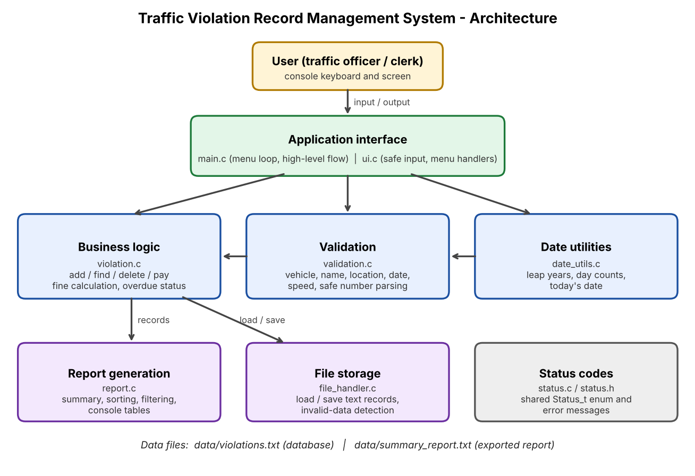
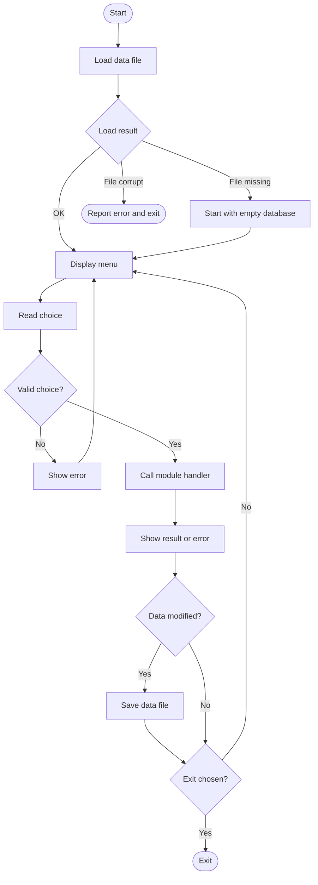

# Project Proposal: Traffic Violation Record Management System

## 1. Project Information

**Project title:** Traffic Violation Record Management System

**Engineering domain:** Transportation

| Field | Details |
|-------|---------|
| Student name | Meet Gupta |
| Roll number | 612507071 |
| Division / batch | EnTC Div 1 |
| Repository name | Traffic-Violation-Record-Management-System |
| GitHub repository link | https://github.com/MeetG-071/Traffic-Violation-Record-Management-System |

**Individual project declaration:** I confirm that this project is my individual work. I understand the design, source code, unit tests, Makefile and documentation included in this repository, and I am prepared to explain or modify any part during evaluation.

Student acknowledgement: Meet Gupta

## 2. Engineering Scenario

### 2.1 Scenario description

The scenario is the record-keeping desk of a city traffic police office or a Regional Transport Office. Traffic officers issue challans for violations such as speeding, jumping a red light, riding without a helmet, not wearing a seatbelt and illegal parking. Clerks then record each violation, collect fines and follow up on unpaid challans.

Currently the records are kept in paper registers or loosely structured spreadsheets. For every violation the office must manage the vehicle number, driver name, location, date, violation type, recorded speed and speed limit (for speeding), fine amount and payment status.

Problems with the current method:

- Finding all violations of one vehicle means searching manually through registers
- Fines are calculated by hand, so they are inconsistent and repeat offenders are not penalised reliably
- Unpaid fines are noticed late because nobody checks how old each challan is
- Duplicate entries and wrongly typed vehicle numbers or dates are not caught
- Producing totals (fines issued, collected, outstanding) is slow and error-prone

### 2.2 Problem statement

In traffic enforcement offices, clerks and traffic officers currently face slow and error-prone handling of violation records. The current method results in inconsistent fines, duplicate or invalid entries, late follow-up of unpaid fines and no quick way to see a vehicle's history or the total outstanding amount. The proposed software will provide validated record entry, automatic fine calculation, search, payment tracking, overdue detection and summary reports so that users can manage violations accurately and follow up on unpaid fines quickly.

### 2.3 Proposed solution

A modular C console application that keeps all violation records in a text file and provides a menu to:

- Add records with strict input validation and duplicate detection
- Calculate fines automatically: speeding fine = base + rate x km/h above the limit, fixed fines for other violations, and a repeat-offender multiplier
- Search by record ID and display the complete history of a vehicle
- Mark fines as paid and delete wrongly entered records
- Decide the payment status of every record (paid, unpaid, overdue after 30 days)
- Sort records by fine amount
- Generate a summary report (totals, collected and outstanding fines, count per violation type) on screen and as an exported text file

Information managed: violation records with ID, vehicle number, driver name, location, date, violation type, speeds, fine amount and payment status.

### 2.4 Target users

| User type | Responsibility | How the user will use the application |
|-----------|----------------|---------------------------------------|
| Traffic officer | Records violations in the field or at the station | Adds new violation records, checks a vehicle's history before issuing a challan |
| Records clerk | Maintains the database and collects fines | Marks fines as paid, searches records, deletes wrongly entered records |
| Supervisor | Monitors fine collection | Views overdue fines, sorted listings and the summary report |

## 3. Project Scope

### 3.1 In-scope features

- Add, list, search by ID, delete violation records
- Vehicle violation history
- Input validation for every field
- Automatic fine calculation including the repeat-offender rule
- Mark fine as paid and detect overdue fines
- Sort records by fine
- Summary report with file export
- Text-file storage with load at start-up and save after every change
- Unit tests, Makefile, documentation

### 3.2 Out-of-scope features

- Graphical or web interface
- Online payment or integration with any government database
- Image / camera evidence or number-plate recognition
- Multi-user access, login and user roles
- Editing an existing record (a wrong record is deleted and re-entered)

### 3.3 Assumptions

- Vehicle numbers are entered without spaces or hyphens (for example `MH12AB1234`) and the input is converted to uppercase
- The system clock of the computer gives the correct current date
- Fines are in Indian Rupees and follow the rules in `config.h`
- One violation of one type, at one place, on one date, for one vehicle is one record
- Up to 500 records are enough for the demonstration

### 3.4 Constraints

- Command-line interface only
- File-based storage (text file), no database
- Fixed maximum of 500 records
- C11 for the application; C++17 allowed only for Google Test files
- Individual project with limited time

## 4. Requirements

### 4.1 Functional requirements

| ID | Functional requirement | Priority | Verification method |
|----|------------------------|----------|---------------------|
| FR-01 | The system shall add a new violation record. | High | Test / Demonstration |
| FR-02 | The system shall validate vehicle number, driver name, location, date, violation type and speeds. | High | Test |
| FR-03 | The system shall reject duplicate records and report when storage is full. | High | Test |
| FR-04 | The system shall calculate the fine automatically, including the repeat-offender rule. | High | Test |
| FR-05 | The system shall list all records. | Medium | Demonstration |
| FR-06 | The system shall search for a record by its ID. | High | Test |
| FR-07 | The system shall show all violations of a given vehicle. | High | Test |
| FR-08 | The system shall mark a fine as paid and reject paying it twice. | Medium | Test |
| FR-09 | The system shall delete a record after confirmation. | Medium | Test |
| FR-10 | The system shall identify unpaid fines older than 30 days as overdue. | High | Test |
| FR-11 | The system shall list records sorted by fine amount, highest first. | Medium | Test |
| FR-12 | The system shall generate a summary report and export it to a text file. | Medium | Test / Demonstration |
| FR-13 | The system shall load records at start-up and save them after every change. | High | Test / Demonstration |

### 4.2 Non-functional requirements

| ID | Non-functional requirement | Verification method |
|----|----------------------------|---------------------|
| NFR-01 | The source code shall compile without warnings (`-Wall -Wextra -Wpedantic`). | Build output |
| NFR-02 | The project shall use a modular multi-file structure with `main.c` only controlling the flow. | Code review |
| NFR-03 | The application shall handle invalid input without crashing. | Negative testing |
| NFR-04 | Important functions shall be tested using Google Test. | Unit-test output |
| NFR-05 | The project shall build and test using a Makefile (`all`, `run`, `test`, `clean`). | Build demonstration |
| NFR-06 | The project shall be maintained in a GitHub repository. | Repository review |
| NFR-07 | The application shall not overwrite a data file it cannot read correctly. | Test |
| NFR-08 | All constants (limits, fines, file names) shall be named in one header. | Code review |

## 5. High-Level Architecture

### 5.1 Architecture description

The software has an interface layer (`main.c`, `ui.c`), a business-logic layer (`violation.c`, `validation.c`, `date_utils.c`), a data-management and storage layer (`file_handler.c`) and a report layer (`report.c`). A shared `Status_t` type (`status.c`) is used for all error reporting.

### 5.2 Architecture diagram

### 5.3 High-level workflow

## 6. Planned Modules (initial)

| Module | Source file | Header file | Responsibility |
|--------|-------------|-------------|----------------|
| Main application | `main.c` | not applicable | High-level control: load, menu loop, save, exit |
| User interface | `ui.c` | `ui.h` | Safe console input, menu and handlers |
| Violation logic | `violation.c` | `violation.h` | Data model, record operations, fine and overdue rules |
| Validation | `validation.c` | `validation.h` | Field validation and number parsing |
| Date utilities | `date_utils.c` | `date_utils.h` | Date parsing and day arithmetic |
| File handler | `file_handler.c` | `file_handler.h` | Load and save records |
| Report | `report.c` | `report.h` | Summaries, sorting, filtering, printing |
| Status | `status.c` | `status.h` | Status codes and messages |

## 7. Planned C Concepts

| Concept | Why it is needed |
|---------|------------------|
| Functions | One responsibility per function, independently testable |
| Structures | Represent a violation record, the record store and the report summary |
| Enumerations | Violation types, payment status and status codes |
| Arrays and strings | Fixed-capacity record storage and bounded text fields |
| Pointers and `const` | Output parameters and read-only access with NULL checks |
| Constants | Limits, fine rules and file names without magic numbers |
| File handling | Persistent storage in a text file with checked operations |
| Dynamic memory allocation | Result lists (sorted, filtered) whose size is known only at run time |
| Error / status codes | Consistent error handling across all modules |
